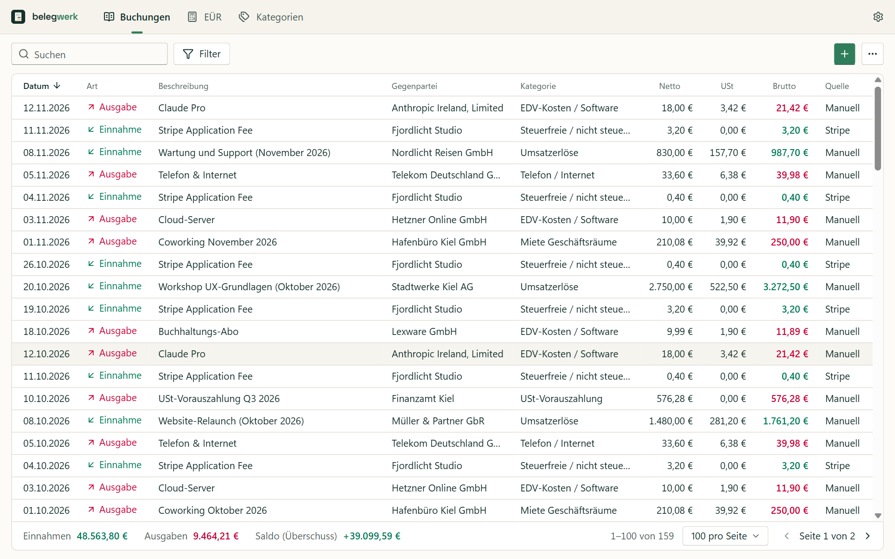

> [!WARNING]
> **100 % vibe-coded – Nutzung auf eigene Gefahr.** Keine Steuerberatung:
> Ergebnisse vor der Übernahme in die Steuererklärung prüfen.

<p align="center">
  <picture>
    <source media="(prefers-color-scheme: dark)" srcset="src/ui/assets/brand/logo-dark.svg">
    
  </picture>
</p>

<p align="center"><b>Deine Buchhaltung. Deine EÜR. Dein Rechner.</b></p>

Belegwerk ist die schlanke Windows-App für Selbstständige, die ihre Einnahmen
und Ausgaben im Griff haben wollen – und am Jahresende eine fertige
**Anlage EÜR** statt eines Schuhkartons voller Zettel. Kein Konto, keine Cloud,
kein Abo: Deine Daten bleiben bei dir.



## Highlights

- **Blitzschnell buchen** – Brutto rein, Netto und USt rechnet Belegwerk aus.
  Textvorschläge für Beschreibung und Gegenpartei inklusive.
- **EÜR auf Knopfdruck** – mit amtlichen Zeilennummern, automatischer
  Umsatzsteuer und Drill-down von jeder Zeile bis zur einzelnen Buchung.
- **Alles sofort gefunden** – Suche, Filter, Sortierung und Summen in
  Echtzeit.
- **Stripe-Import** – Application Fees und Rückerstattungen landen
  automatisch und ohne Duplikate in deinen Büchern.
- **Kleinunternehmer-ready** – Steuerstatus nach § 19 UStG pro Jahr.
- **Excel-freundlicher CSV-Export** – für Buchungen und EÜR.
- **100 % lokal** – eine SQLite-Datei auf deinem Rechner, Backup mit einem
  Klick.
- **Native Windows-11-Optik** – eine einzige `.exe`, kein Installer,
  Auto-Update eingebaut.

## Loslegen

Neueste `belegwerk-<version>.exe` aus den
[Releases](https://github.com/patrick-b6n/belegwerk-next/releases) laden,
starten, fertig. Alles Weitere – SmartScreen, Backup, Stripe – steht im
[Handbuch](docs/handbuch.md).

## Development

Prerequisites: Windows, Node.js ≥ 26, pnpm 12, Rust (MSVC) and the
[Tauri prerequisites](https://v2.tauri.app/start/prerequisites/#windows).

```sh
pnpm install
pnpm tauri dev   # desktop app with its own dev database and sample data
pnpm verify      # format, lint, typecheck, tests – before every commit
pnpm release     # build the release .exe into release/
```

Details: [Development](docs/development.md) ·
[Architecture](docs/architecture.md) · [Data model](docs/data-model.md) ·
[Tests](docs/testing.md) · [Release](docs/release.md)
